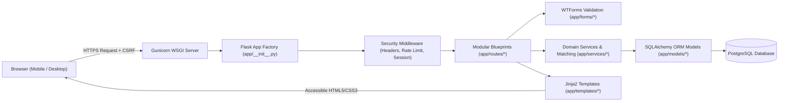

# Earn & Pay — Technical Architecture & Database Schema

**Document Version:** 1.0 (Phase 1 Baseline)  
**Stack:** Python + Flask (Application Factory + Blueprints) + SQLAlchemy + Alembic + PostgreSQL + Jinja2 + HTML5/CSS3/Vanilla JS

---

## 1. Architectural Philosophy

Earn & Pay uses a **modular server-rendered monolith** pattern. By rendering HTML templates on the server via Jinja2 and enhancing interactivity with focused Vanilla JavaScript, the platform avoids the complexity, bundle size, and dual-validation hazards of Single-Page Application (SPA) frameworks while maintaining strict separation of concerns across domain layers:



---

## 2. Project Folder Structure

```text
d:\E&P\
├── app/
│   ├── __init__.py              # Flask application factory, error handlers, security headers, CLI
│   ├── extensions.py            # Unbound extension instances (db, migrate, login_manager, csrf)
│   ├── models/                  # Normalized SQLAlchemy relational entities
│   │   └── __init__.py
│   ├── routes/                  # Modular Flask Blueprints (system, public, auth, jobs, profiles, applications, admin)
│   │   ├── __init__.py
│   │   └── system.py            # Health & database connectivity verification endpoints
│   ├── services/                # Business logic, rule-based matching, transactional workflows
│   │   └── __init__.py
│   ├── forms/                   # Flask-WTF / WTForms input validation schemas
│   │   └── __init__.py
│   ├── utils/                   # Security helpers, decorators, normalization utilities
│   │   ├── __init__.py
│   │   └── security.py          # Safe redirect validation, header hardening, email normalization
│   ├── templates/               # Server-rendered Jinja2 HTML templates
│   │   └── errors/              # Accessible 403, 404, 500 error pages
│   └── static/                  # Static assets (CSS design tokens, layouts, JS modules, icons)
│       ├── css/
│       │   └── tokens.css       # Editorial Local-Work Marketplace CSS custom properties
│       └── js/
├── migrations/                  # Flask-Migrate / Alembic schema revision history
├── tests/                       # Automated pytest suite & isolated fixtures
│   ├── conftest.py
│   └── test_phase2_foundation.py
├── docs/                        # Engineering & operational documentation
│   ├── prd.md
│   ├── architecture.md
│   └── design_system.md
├── config.py                    # Environment-separated configuration classes
├── wsgi.py                      # Production WSGI entry point
├── requirements.txt             # Pinned Python dependencies
├── pyproject.toml               # Pytest and Ruff configuration
├── .env.example                 # Safe template for environment variables
├── .gitignore                   # Git exclusion rules
└── README.md                    # Developer setup, testing, and operations guide
```

---

## 3. Initial Database Entity-Relationship Diagram (ERD)

```mermaid
erDiagram
    USERS ||--o| WORKER_PROFILES : "has one (role=worker)"
    USERS ||--o| EMPLOYER_PROFILES : "has one (role=employer)"
    EMPLOYER_PROFILES ||--o{ JOBS : "publishes"
    JOBS ||--o{ JOB_APPLICATIONS : "receives"
    WORKER_PROFILES ||--o{ JOB_APPLICATIONS : "submits"
    WORKER_PROFILES ||--o{ SAVED_JOBS : "bookmarks"
    JOBS ||--o{ SAVED_JOBS : "is bookmarked in"
    USERS ||--o{ NOTIFICATIONS : "receives"
    USERS ||--o{ VERIFICATION_TOKENS : "owns"
    USERS ||--o{ PASSWORD_RESET_TOKENS : "owns"
    USERS ||--o{ REPORTS : "submits (reporter)"
    USERS ||--o{ REPORTS : "reviews (reviewer)"
    USERS ||--o{ AUDIT_EVENTS : "triggers (actor)"

    USERS {
        bigint id PK
        varchar full_name "NOT NULL"
        varchar normalized_email UK "NOT NULL, UNIQUE, INDEX"
        varchar password_hash "NOT NULL"
        varchar role "CHECK (worker, employer, admin)"
        varchar account_status "CHECK (active, pending_verification, suspended, deleted)"
        boolean email_verified "DEFAULT false"
        timestamptz created_at "UTC NOT NULL"
        timestamptz updated_at "UTC NOT NULL"
    }

    WORKER_PROFILES {
        bigint id PK
        bigint user_id FK "UNIQUE, NOT NULL -> users.id"
        varchar phone_number "Optional"
        text skills "Normalized comma/array list"
        text experience_summary
        varchar preferred_categories
        varchar preferred_location "Locality / Neighborhood"
        varchar pincode "INDEX (6-digit Indian pincode)"
        integer travel_radius_km "CHECK >= 0"
        varchar availability "daily, part_time, weekends, flexible"
        numeric expected_daily_wage "CHECK >= 0"
        boolean show_phone_to_employers "Privacy control DEFAULT false"
        boolean is_profile_public "Privacy control DEFAULT true"
        timestamptz updated_at "UTC NOT NULL"
    }

    EMPLOYER_PROFILES {
        bigint id PK
        bigint user_id FK "UNIQUE, NOT NULL -> users.id"
        varchar business_name "NOT NULL"
        varchar business_type "shop, restaurant, logistics, service, individual"
        text description
        text address
        varchar location "Locality / City"
        varchar pincode "INDEX"
        varchar contact_phone
        varchar verification_status "CHECK (unverified, pending, verified)"
        text verification_notes "Admin-only verification record"
        timestamptz verified_at "UTC NULL"
        timestamptz updated_at "UTC NOT NULL"
    }

    JOBS {
        bigint id PK
        bigint employer_id FK "NOT NULL -> employer_profiles.id, INDEX"
        varchar title "NOT NULL"
        varchar category "NOT NULL, INDEX"
        varchar job_type "CHECK (daily_wage, part_time, temporary, full_time)"
        text description "NOT NULL"
        text responsibilities "NOT NULL"
        text required_skills
        varchar experience_required
        varchar location "NOT NULL, INDEX"
        varchar pincode "NOT NULL, INDEX"
        numeric wage_amount "NOT NULL, CHECK > 0"
        varchar currency "DEFAULT 'INR' NOT NULL"
        varchar wage_frequency "CHECK (hourly, daily, weekly, monthly, fixed_shift)"
        varchar working_hours "e.g., 9:00 AM - 6:00 PM (8 hrs)"
        integer vacancies "NOT NULL, CHECK >= 1"
        date application_deadline "NOT NULL, INDEX"
        varchar status "CHECK (draft, published, closed, archived), INDEX"
        timestamptz published_at "UTC NULL"
        timestamptz created_at "UTC NOT NULL"
        timestamptz updated_at "UTC NOT NULL"
    }

    JOB_APPLICATIONS {
        bigint id PK
        bigint job_id FK "NOT NULL -> jobs.id, INDEX"
        bigint worker_id FK "NOT NULL -> worker_profiles.id, INDEX"
        varchar status "CHECK (applied, under_review, shortlisted, interview_scheduled, accepted, rejected, withdrawn)"
        text cover_note
        text employer_private_notes "Visible only to owning employer"
        timestamptz interview_scheduled_at "UTC NULL"
        varchar interview_details "Location/phone instructions"
        timestamptz applied_at "UTC NOT NULL"
        timestamptz updated_at "UTC NOT NULL"
    }

    SAVED_JOBS {
        bigint id PK
        bigint worker_id FK "NOT NULL -> worker_profiles.id"
        bigint job_id FK "NOT NULL -> jobs.id"
        timestamptz saved_at "UTC NOT NULL"
    }

    NOTIFICATIONS {
        bigint id PK
        bigint user_id FK "NOT NULL -> users.id, INDEX"
        varchar notification_type "application_status, job_alert, moderation, system"
        varchar title "NOT NULL"
        text message "NOT NULL (No sensitive PII)"
        varchar link_url "Safe relative URL"
        timestamptz read_at "UTC NULL"
        timestamptz created_at "UTC NOT NULL"
    }

    VERIFICATION_TOKENS {
        bigint id PK
        bigint user_id FK "NOT NULL -> users.id"
        varchar token_hash UK "SHA-256 hash, NOT NULL"
        timestamptz expires_at "UTC NOT NULL"
        timestamptz used_at "UTC NULL"
        timestamptz created_at "UTC NOT NULL"
    }

    PASSWORD_RESET_TOKENS {
        bigint id PK
        bigint user_id FK "NOT NULL -> users.id"
        varchar token_hash UK "SHA-256 hash, NOT NULL"
        timestamptz expires_at "UTC NOT NULL"
        timestamptz used_at "UTC NULL"
        timestamptz created_at "UTC NOT NULL"
    }

    REPORTS {
        bigint id PK
        bigint reporter_id FK "NOT NULL -> users.id"
        varchar target_type "CHECK (job, employer, worker)"
        bigint target_id "NOT NULL"
        varchar reason "fee_demand, misleading_wage, fake_job, harassment, other"
        text details
        varchar status "CHECK (open, investigating, resolved, dismissed)"
        bigint reviewer_id FK "NULL -> users.id"
        varchar moderation_action "none, listing_hidden, account_suspended, warning_issued"
        text resolution_notes
        timestamptz created_at "UTC NOT NULL"
        timestamptz resolved_at "UTC NULL"
    }

    AUDIT_EVENTS {
        bigint id PK
        bigint actor_id FK "NULL -> users.id"
        varchar action "e.g., user.login, job.publish, application.accept, report.resolve"
        varchar resource_type "user, job, application, report"
        bigint resource_id
        jsonb safe_metadata "Sanitized context (never secrets/passwords)"
        varchar ip_address
        timestamptz created_at "UTC NOT NULL, INDEX"
    }
```



---

## 4. Database Invariants & Transaction Rules

1. **Duplicate Prevention:**
   - `UNIQUE (job_id, worker_id)` on `job_applications` ensures a worker can never submit duplicate applications to the same job, even under concurrent requests.
   - `UNIQUE (worker_id, job_id)` on `saved_jobs` prevents duplicate bookmarks.
   - `UNIQUE (normalized_email)` on `users` prevents case-variant duplicate registrations.
2. **Domain Check Constraints:**
   - `jobs.wage_amount > 0` and `jobs.vacancies >= 1`.
   - Enumerated `CHECK` constraints on `users.role`, `users.account_status`, `jobs.status`, `jobs.wage_frequency`, `job_applications.status`, and `employer_profiles.verification_status`.
3. **Timezone Discipline:**
   - Every timestamp column uses `TIMESTAMP WITH TIME ZONE` (`DateTime(timezone=True)`) initialized to `datetime.now(timezone.utc)`.
4. **Concurrency & Ownership:**
   - Accepting an application or modifying job status uses an atomic database transaction verifying `job.employer.user_id == current_user.id` on the server.
