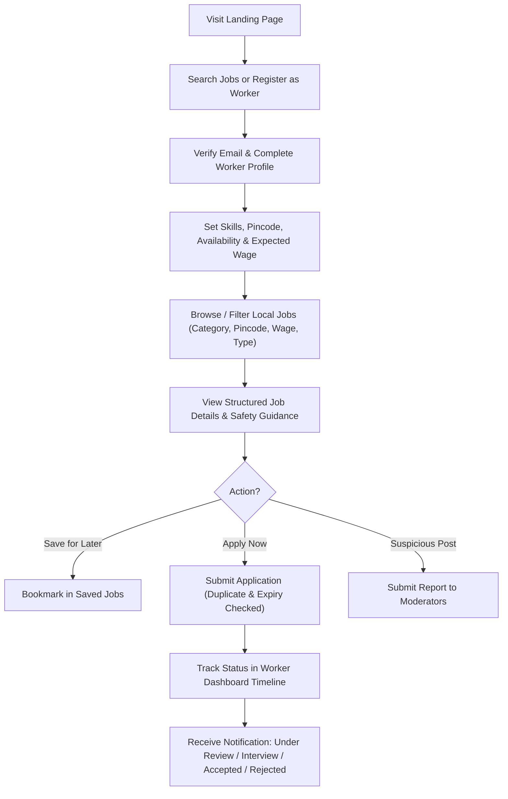
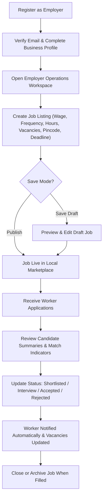
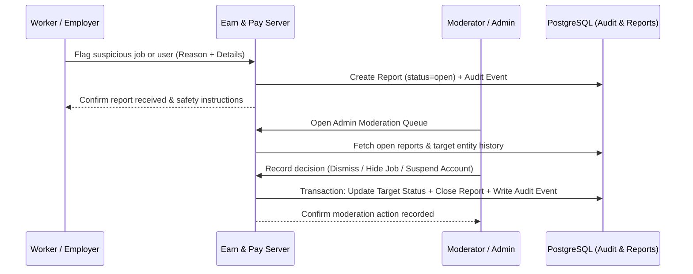

# Earn & Pay — Product Requirements Document (PRD)

**Document Version:** 1.0 (Phase 1 Baseline)  
**Product Category:** Hyper-Local Employment & Temporary-Work Marketplace  
**Initial Target Market:** Single launch city/cluster in India  
**Platform:** Mobile-First Responsive Web Application (Server-Rendered Python/Flask + PostgreSQL)

---

## 1. Product Vision & Mission

### 1.1 Vision
Connect people seeking local work with employers who need reliable workers through a transparent, dignified, and accessible digital marketplace.

### 1.2 Mission
Make local employment discovery simpler, more transparent, and more accessible for India's part-time, temporary, and daily-wage workforce and small neighborhood businesses.

### 1.3 Core Product Integrity Principle
> **Important:** Earn & Pay must **never** promise guaranteed employment, guaranteed income, or claim that every employer/worker is verified unless a real, documented verification procedure has been completed for that specific account. Furthermore, the MVP must **not** implement an internal wallet or hold customer funds.

---

## 2. Problem Statement & Core Hypotheses

In Indian cities and commercial neighborhoods, workers seeking daily-wage, temporary, or part-time roles face fragmented discovery channels (word-of-mouth, physical notice boards, unverified WhatsApp forwards) that frequently omit critical terms: exact wages, payment frequency, shift timings, work location, and core duties. Furthermore, applicants rarely receive feedback on whether their application was seen, shortlisted, or rejected.

Simultaneously, small business owners—retail shopkeepers, restaurant managers, logistics hubs, and local service providers—face urgent staffing gaps and lack a structured, low-friction tool to publish clear vacancies, compare local candidates, and track hiring decisions.

### 2.1 Hypotheses to Validate in the Pilot
1. **Discovery Friction:** Workers struggle to discover nearby jobs matching their availability, skills, and wage expectations.
2. **Term Ambiguity:** Informal job posts frequently omit wage amount, payment frequency (daily/weekly/monthly), working hours, pincode, or job duties.
3. **Employer Screening Overhead:** Small employers spend excessive time sourcing and comparing candidates via phone calls or walk-ins.
4. **Application Black Hole:** Workers have no visibility into whether their application is pending, under review, accepted, or rejected.
5. **Trust & Safety Need:** Both sides require accessible reporting mechanisms for suspicious, misleading, or unsafe job listings.

---

## 3. Target User Personas & Scope

| Persona | Core Needs | MVP Capabilities |
| :--- | :--- | :--- |
| **Workers / Job Seekers** | Find nearby roles, verify exact wage and shift terms upfront, apply quickly on mobile, track application status. | Registration, worker profile with privacy controls, keyword/location/category/wage search, saved jobs, 1-click apply, status timeline, in-app notifications. |
| **Employers / Shopkeepers** | Fill vacancies quickly, publish clear job terms, review candidate profiles, record hiring outcomes. | Registration, employer business profile, draft/publish/close jobs, applicant management workspace, status transitions, interview scheduling, private notes. |
| **Administrators / Moderators** | Enforce platform rules, investigate reported jobs/users, maintain audit trail. | Restricted admin console, report review queue, listing takedown/moderation actions, user account status controls, immutable audit events. |

---

## 4. User Journey Diagrams

### 4.1 Worker End-to-End Journey

### 4.2 Employer End-to-End Journey

### 4.3 Trust, Reporting & Moderation Journey

---

## 5. Functional Requirements Summary

1. **Authentication & RBAC (`auth`):**
   - Role selection (`worker`, `employer`) at registration; `admin` provisioned securely via CLI/seed.
   - Werkzeug salted password hashing; single-use expiring tokens (SHA-256 hashed at rest) for email verification and password reset.
   - Enumeration-safe password recovery responses.
   - Server-side role and resource ownership checks on every route.
2. **Profiles (`profiles`):**
   - Worker profile: skills, experience, preferred categories, preferred location/pincode, travel distance, availability, expected wage, field-level visibility controls.
   - Employer profile: business name, description, address, locality, pincode, truthful verification status badge (`unverified`, `pending`, `verified`).
3. **Jobs & Discovery (`jobs`):**
   - Full lifecycle: `draft` -> `published` -> `closed` / `archived`.
   - Mandatory structured compensation: exact numeric wage (`INR`), payment frequency (`hourly`, `daily`, `weekly`, `monthly`, `fixed_shift`), schedule/hours, vacancies, and application deadline.
   - Search & filter by keyword, category, location/pincode, job type (`daily_wage`, `part_time`, `temporary`, `full_time`), wage range, and sorting.
   - Explainable, rule-based job recommendations matching worker skills, category, pincode, availability, and expected wage.
4. **Applications & Hiring (`applications`):**
   - Database-enforced unique constraint preventing duplicate applications (`job_id + worker_id`).
   - Server-side rejection of applications to `draft`, `closed`, `archived`, or past-deadline jobs.
   - Controlled status transitions (`applied`, `under_review`, `shortlisted`, `interview_scheduled`, `accepted`, `rejected`, `withdrawn`) with row-level locking (`SELECT ... FOR UPDATE`) when accepting candidates against remaining vacancies.
5. **Trust, Safety & Admin (`admin`):**
   - Reporting flow for suspicious jobs (e.g., upfront fee requests, misleading wages, unsafe locations).
   - Admin moderation queue with full audit logging (`audit_events`).
   - Account deletion request workflow and privacy settings.

---

## 6. Non-Functional Requirements

- **Accessibility:** WCAG 2.1 AA compliance, semantic landmarks, full keyboard operability, visible focus rings, screen-reader error announcements (`aria-live`, `aria-invalid`).
- **Performance:** Lightweight server-rendered HTML/CSS/JS with zero bloated frontend bundles; rapid load times on budget Android devices over 3G/4G connections.
- **Security:** CSRF tokens on all state-changing requests, parameterized SQLAlchemy queries, rate-limited authentication endpoints, strict HTTP security headers, `HttpOnly`/`SameSite=Lax` cookies (`Secure` in production).
- **Reliability:** ACID transactions on all multi-record writes, UTC timezone-aware timestamps, health-check endpoints (`/health`, `/health/db`).
